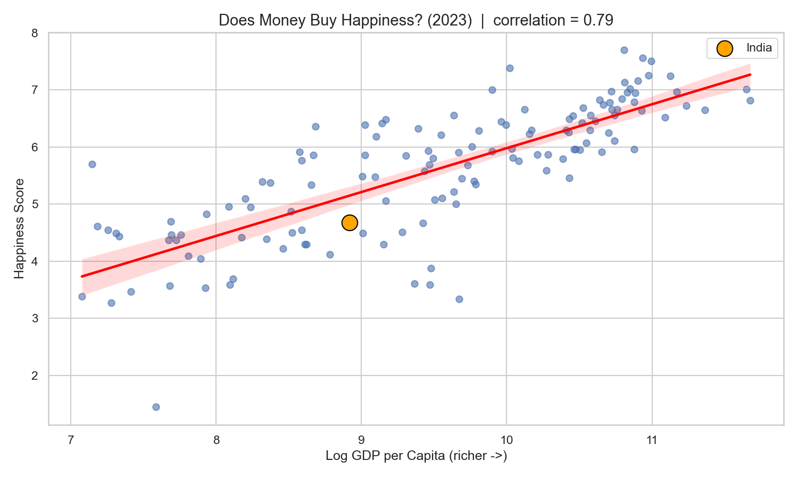
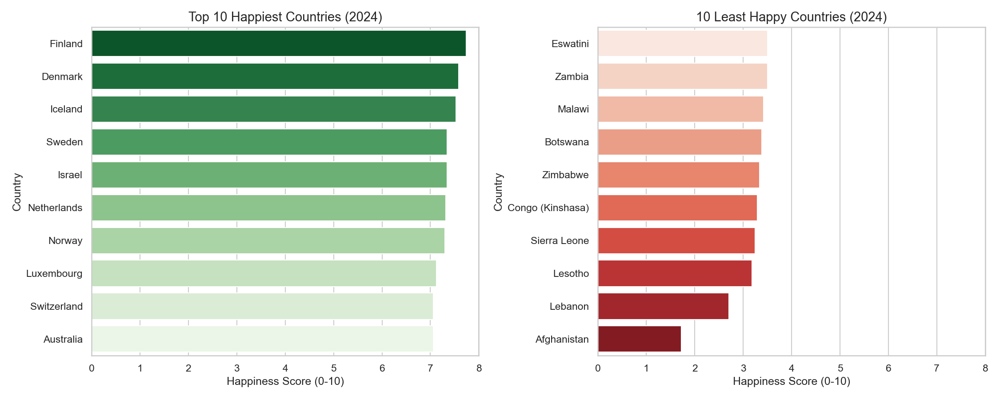
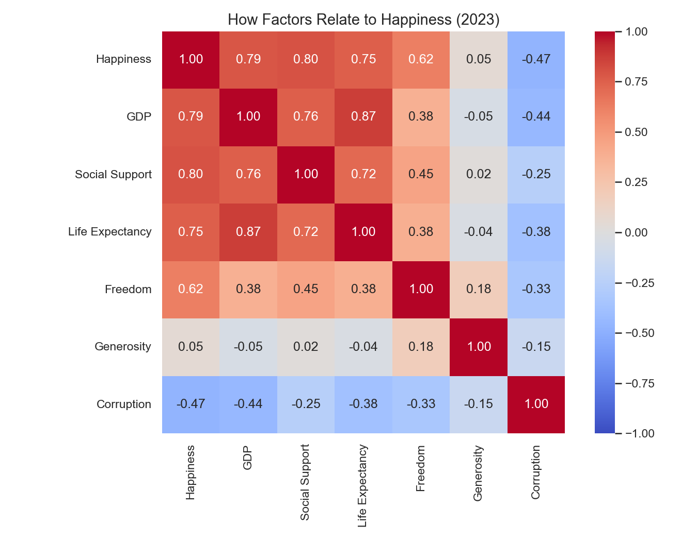
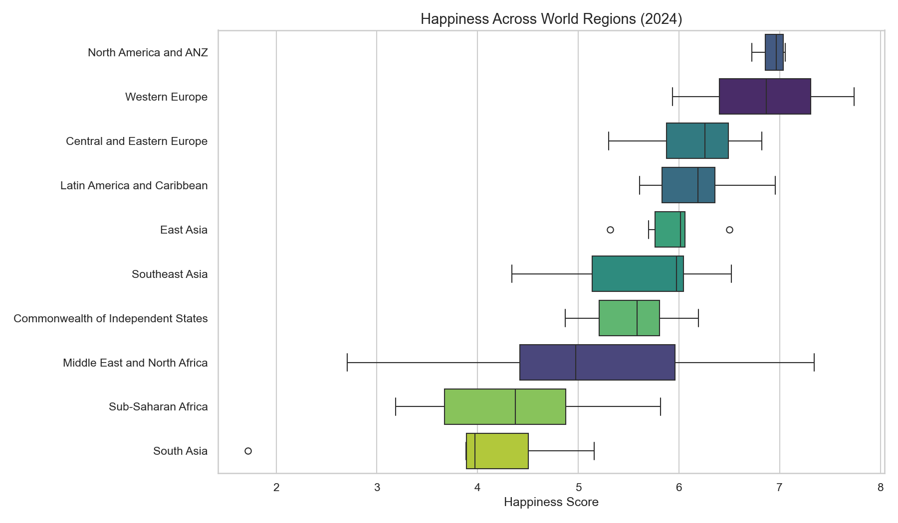
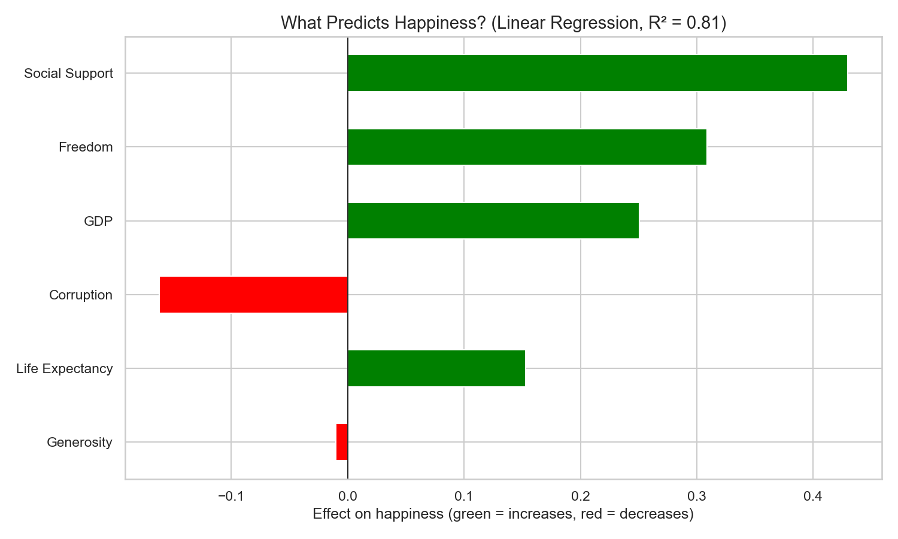

# World Happiness Dashboard: Does Money Buy Happiness?

An analysis of the World Happiness Report with nine visualizations and an interactive Streamlit dashboard backed by an SQLite database. Built for the Data Visualization using Python course (AID30050).



## Key findings

- **Finland is the happiest country in 2024 (7.74). India ranks #126 of 143 (4.05).**
- **Richer countries tend to be happier:** the correlation between log GDP per capita and happiness is 0.79 across 135 countries in 2023.
- **GDP is not the strongest factor.** A linear regression on six factors (R² = 0.81, 2023) gives social support the largest standardized coefficient (0.43), ahead of freedom (0.31) and GDP (0.25). Generosity has almost no effect.

These are associations from one year of country-level data, not causal effects. The R² is measured on the same 135 countries the model was fitted on.

## Visualizations

| | |
|---|---|
|  |  |
|  |  |

Three more charts (world map, animated bubble chart, India vs neighbours radar) are interactive Plotly HTML files. They are generated into `charts/` when you run the analysis script.

## Dashboard

The Streamlit app (`app.py`) has seven tabs, a country picker, and an SQLite database (`db.py`). The data is imported from the CSV files on first run. You can then insert, update and delete country-year rows, and every change is recorded in an activity log.

## Dataset

[World Happiness Report 2024 (Kaggle)](https://www.kaggle.com/datasets/jainaru/world-happiness-report-2024-yearly-updated). It has two files: a 2024 ranking of 143 countries, and yearly data for 165 countries from 2005 to 2023. Download both CSVs into an `archive/` folder next to `app.py`.

## Run it

```bash
pip install -r requirements.txt
streamlit run app.py --server.address localhost   # dashboard
python happiness_project.py                       # saves the nine charts to charts/
```

## Files

| File | Purpose |
|---|---|
| `app.py` | Streamlit dashboard (7 tabs) |
| `db.py` | SQLite layer: import, insert, update, delete, activity log |
| `happiness_project.py` | Analysis script that produces the nine charts |
| `charts/` | Saved charts |

## Limitations

- Findings use the latest year of the yearly data (2023) for correlation and regression, and the 2024 file for the country ranking, so the two are from different years.
- Missing values in the yearly data were filled with each country's own average.
- Countries missing from the 2024 file have no region and are grouped as "Other".
